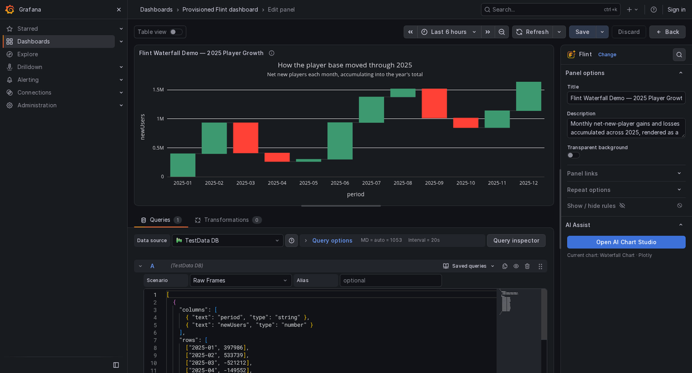
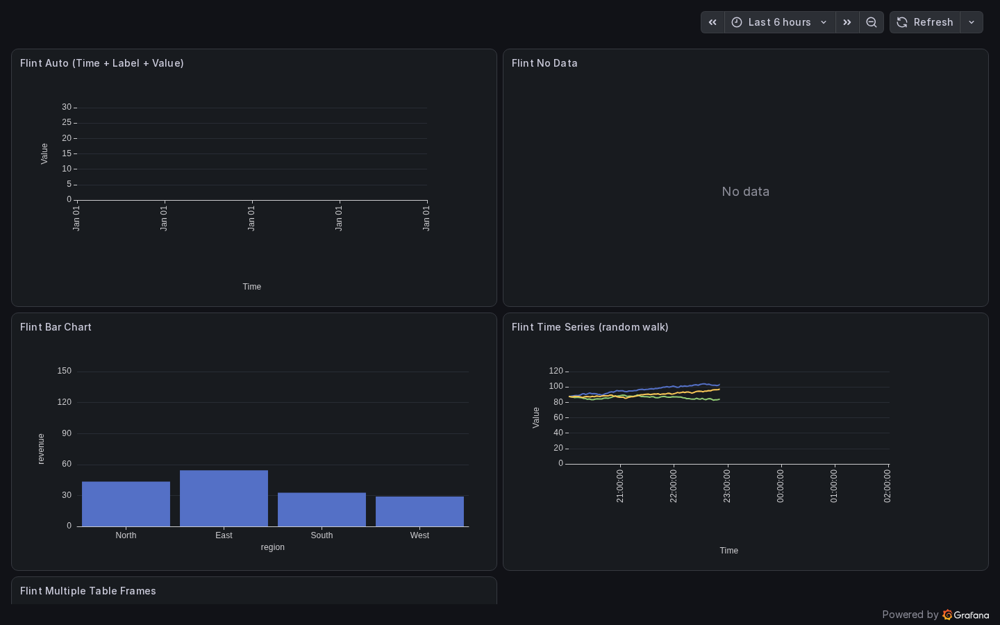

#  Flint Panel for Grafana

[English](README.md) | [简体中文](README.zh-CN.md)

Flint is an AI-assisted visualization panel for Grafana, powered by [Microsoft Flint](https://github.com/microsoft/flint-chart). Describe the chart you want in AI Chat, generate a proposal grounded in the current Grafana query frames, review it in a live preview, and explicitly apply it to the panel. Flint then renders the result with Apache ECharts, Vega-Lite, Plotly, or Chart.js.

> [!WARNING]
> **Project status: experimental, research-oriented proof of concept (POC).** This repository demonstrates and evaluates a Grafana integration with Flint and AI-generated visualization proposals; it is not production-ready and does not provide a stable compatibility or migration guarantee. Treat every AI proposal as untrusted: Create mode can regenerate chart type, field bindings or Flint Spec; Refine mode permits title, subtitle and field display-name changes, plus series colors for supported multi-measure charts. Review the preview and Chart Settings before Apply. See [Project status and maturity](docs/project-status.md).

**Chart Settings works without AI.** Select a chart type, bind query fields, choose multiple value fields, and adjust supported chart options in the Chart workbench. AI Chat is an optional way to modify the same Flint source. Conversational generation uses the separately installed [Flint AI Datasource](https://github.com/IBUMBLEBEE/grafana-flintai-datasource) plugin, keeping provider configuration and credentials outside the panel.



## Highlights

- Create and refine charts through AI Chat using the current Grafana query context.
- Review generated drafts in a live preview before explicitly applying or discarding them.
- Render approved charts with Apache ECharts, Vega-Lite, Plotly, or Chart.js.
- Use Auto, manual settings, or specification editors when more control is needed.

## Compatibility

| Component               | Supported version |
| ----------------------- | ----------------- |
| Grafana                 | 12.3.0 or later   |
| Node.js for development | 22 or later       |
| Package manager         | npm 10            |

The browser test suite covers the minimum supported Grafana 12.3 line and the current Grafana 13 line.

## Getting started

### Run the development environment

```bash
npm ci
npm run build
docker compose up --build
```

Open <http://localhost:3000>, then select **Provisioned Flint dashboard**. The default Compose setup builds and mounts this panel and uses Grafana's built-in TestData datasource; it does not require a sibling datasource repository.

For incremental frontend development, run:

```bash
npm run dev
```

### Install the AI dependency

AI Chat and chart generation require the companion [Flint AI Datasource](https://github.com/IBUMBLEBEE/grafana-flintai-datasource) plugin. Its current requirements specify **Grafana 13.1.0 or later**; the panel's automatic and manual chart features support Grafana 12.3.0 or later without this dependency.

1. Install Flint AI Datasource in the same Grafana instance, following its [project documentation](https://github.com/IBUMBLEBEE/grafana-flintai-datasource#readme).
2. Add a Flint AI Datasource instance and configure its provider, API token, and model. Test the AI connection and save the datasource.
3. Open Flint Panel's Chart workbench and select the configured model.

The datasource manages AI requests and credentials. Keep the panel's queries connected to the business datasource that supplies the chart data.

### Create a visualization without AI

1. Run the Panel queries and apply Grafana transformations to prepare the data.
2. Expand **Chart settings → Open Chart workbench → Chart Settings**.
3. Choose a chart type. Field controls adapt to the chart, including group, pie value/category, and heatmap color-value fields.
4. Select one or more numeric Y fields for supported line, area and bar charts. Auto shows inferred fields; clearing a value selection restores Auto.
5. Adjust the available chart options and Tooltip. Default/Reset removes an option override.
6. Review **UI Preview**, then **Apply to panel**. Save the dashboard to persist the changes.

Compatible bindings and options survive chart switches. Missing query fields require replacement. AI proposals preserve omitted compatible settings and use the current preview draft as their starting point. Under Vega-Lite, **Theme preset** offers the installed Flint official presets and **Default (Flint)**. Other backends disable theme selection and show an unsupported notice; the saved preset is retained for switching back to Vega-Lite. Theme changes use preview and Apply; custom theme objects are not supported.

### Create a visualization with AI Assist

1. Add a panel to a Grafana dashboard and configure its query.
2. Select the **Flint** visualization.
3. Expand **Chart settings** and open **Chart workbench**.
4. Select a configured model, describe the chart or change you want in **AI Chat**, and send the request.
5. Select **Generate proposal**. AI reads the conversation and current chart to choose local adjustments or a redesign; ambiguous requests get a clarification question. Review the stated scope and preview before Apply.
6. Review the live preview and, if needed, refine the request or adjust Chart Settings, Flint Spec, or UI Framework Spec.
7. Select **Apply to panel** to commit the draft, or **Discard edits** to leave the panel unchanged.

If no AI provider is configured, keep **Chart type** set to **Auto** or use the manual Chart Studio controls.

## Rendering backends

| Backend        | Best suited for                                         |
| -------------- | ------------------------------------------------------- |
| Apache ECharts | Default and most broadly tested Grafana dashboards      |
| Vega-Lite      | Declarative statistical and grammar-based visualization |
| Plotly         | Interactive scientific and statistical charts           |
| Chart.js       | Lightweight canvas charts for common use cases          |

Renderer code is loaded on demand, so opening a normal Flint panel does not eagerly load every backend.



## Chart Studio

Chart Studio is the AI-assisted chart creation and review workspace inside the Grafana panel editor:

- **AI Chat** accepts natural-language chart requests and follow-up refinements based on the current data context.
- **Automatic proposal planning** determines local adjustments or a redesign from the conversation and current chart, and shows the intended scope for review.
- **Generate proposal** converts the conversation into a validated, unapplied chart draft.
- **UI Preview** renders the current panel or the proposed draft with the actual query frames.
- **Chart Settings** provides reviewable chart type and field mapping controls.
- **Flint Spec** exposes the semantic visualization specification.
- **UI Framework Spec** exposes read-only compiled backend-native configuration.
- **Apply to panel** is the explicit boundary between an AI proposal and the saved panel configuration.

Drafts are tied to the current dashboard, panel, query, and field schema. If that context changes, stale drafts are prevented from being applied.

## How it works

```text
Grafana query frames
  -> build a redacted data hint and field schema
  -> combine them with the AI Chat request and conversation
  -> generate and validate a Flint chart proposal
  -> stage a data-free Flint source proposal
  -> bind current query rows and host dimensions
  -> compile for the selected rendering backend and preview
  -> explicitly Apply the source to panel options
  -> save the dashboard to persist it
  -> rebind and recompile on query refresh or resize
```

The AI workflow uses the query frames already attached to the Grafana panel. It does not introduce a second business-data selector. After a proposal is applied, the panel can continue rendering it without an active AI request.

## AI Assist setup and safety

After applying a chart, ask in chat to undo or restore an earlier version. AI selects a saved version and the Panel prepares an exact snapshot preview; **Restore this version** commits it after your review. **Undo last apply** also prepares a preview. **Chart history** offers earlier snapshots directly. Up to 10 data-free versions are retained in this tab's session storage, including the original source, Auto bindings and series colors. Clearing chat keeps chart history. Changes outside recorded history or to the query invalidate restoration until a new application starts a matching history. Saving the Dashboard remains a separate Grafana action. Diagnostic exports include the history and restore availability.

For development debugging, use **Export diagnostics** (the download icon in the AI Chat header). It downloads a JSON file with the retained conversation, current source and proposal, preview/errors, query field metadata, and the last 20 host AI calls in this editor. Credentials, query rows and data samples are excluded. The trace is kept in memory, starts when the editor mounts, and resets when chat is cleared; backend internal retries are not included. Export does not apply or save a chart.

Install and configure [Flint AI Datasource](https://github.com/IBUMBLEBEE/grafana-flintai-datasource) as described in [Install the AI dependency](#install-the-ai-dependency), then select its model from the Chart workbench. Automatic and manual chart creation remain available when that service is unavailable.

The integration follows these boundaries:

- Provider credentials belong to the datasource and are stored by Grafana in `secureJsonData`.
- Flint Panel and dashboard JSON do not store provider API keys.
- Chat history is bounded and temporary to the browser session.
- Provider-facing data hints are redacted, size-limited, and omit business datasource identities.
- Provider responses are normalized to canonical, data-free Flint source before preview or Apply; legacy field selections are accepted only at the Provider compatibility boundary.
- AI plans the change from the full conversation. Local adjustments include the current source, lock data semantics and use the same guards during repair; a failed local change never retries as a redesign.
- AI-generated options are validated against the current query fields and compiled by the installed `flint-chart` runtime.
- One bounded repair may receive the exact compiler error. Refine never falls back to scalar fields; Create can use genuine legacy selections only after validation and compilation, with the rejection reason shown.
- The saved Flint source cannot embed query rows. Compiled UI Framework Spec is read-only.
- A proposal never changes the panel until the user selects Apply.

Mock Provider browser checks exercise the Panel's safeguards without API keys; they do not verify real LLM or separately installed datasource compatibility.

## Panel options contract

Agents and provisioning tools can use the following shape:

```json
{
  "type": "ibumblebee-flint-panel",
  "options": {
    "stateVersion": 1,
    "renderBackend": "echarts",
    "bindingMode": "auto",
    "flintInput": {
      "chart_spec": { "chartType": "Line Chart", "encodings": {} }
    },
    "ai": {
      "lastPrompt": ""
    }
  }
}
```

External agents should write structured, data-free `flintInput`. Chart Settings and Flint Spec edit the same source. Backend output is compiled at runtime; framework overrides are no longer supported. See the complete [options schema](docs/schemas/flint-panel-options.schema.json) and [Grafana MCP contract](docs/agent-flint-grafana.md).

## Development and verification

Run the same checks used by CI:

```bash
npm run format:check
npm run check:flint-contract
npm run typecheck
npm run lint
npm run test:ci
npm run audit:prod
npm run build
npm run e2e
```

Useful commands:

| Command           | Purpose                                   |
| ----------------- | ----------------------------------------- |
| `npm run dev`     | Watch and rebuild the frontend            |
| `npm run test:ci` | Run the Jest unit suite                   |
| `npm run e2e`     | Run Grafana browser tests with Playwright |
| `npm run build`   | Create the production plugin in `dist/`   |
| `npm run sign`    | Sign an approved plugin build             |

## Project structure

```text
src/components/     Panel, Chart Studio, preview, and chat UI
src/flint/          Data conversion, validation, compilation, and renderers
src/ai/             Panel context, proposals, provider client, and temporary chat
tests/              Grafana Playwright end-to-end tests
provisioning/       Local dashboards and datasource fixtures
docs/               Requirements, schemas, design notes, and MCP examples
```

## Documentation

- [Project status and maturity](docs/project-status.md)
- [Documentation index](docs/README.md)
- [Product roadmap](docs/product-roadmap.md)
- [Agent and Grafana MCP contract](docs/agent-flint-grafana.md)
- [Panel options schema](docs/schemas/flint-panel-options.schema.json)
- [Security policy](SECURITY.md)
- [Contributing guide](CONTRIBUTING.md)
- [Changelog](CHANGELOG.md)

## Packaging and release

A release archive must contain a top-level directory named after the plugin ID:

```text
ibumblebee-flint-panel/
  plugin.json
  module.js
  README.md
  LICENSE
  ...
```

Public Grafana submissions also require a public source repository, a release archive, its SHA1 checksum, testing guidance, and a Grafana Cloud organization matching the `ibumblebee` plugin ID prefix. New public plugins are expected to be unsigned during their initial review and are signed after approval.

## Contributing

Contributions are welcome. Read [CONTRIBUTING.md](CONTRIBUTING.md) before opening an issue or pull request. Report security vulnerabilities privately as described in [SECURITY.md](SECURITY.md).

## Acknowledgements

Flint Panel builds on Microsoft Flint, Grafana, Apache ECharts, Vega and Vega-Lite, Plotly.js, Chart.js, and assistant-ui. Production archives include dependency license information in `LICENSE.txt`.

## License

Licensed under Apache-2.0. See [LICENSE](LICENSE).
